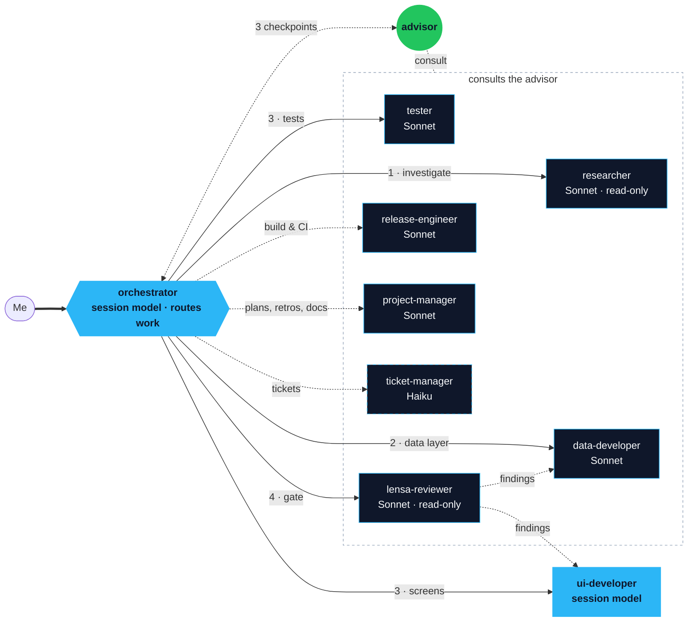

# Hi there , I'm Abdur Rohman

call me <b>Rohman</b> or <b>Maman</b>

  
  
  
  
  

 

### About

Senior Mobile Developer with **5+ years** building production Flutter apps and growing engineering talent. Hands-on with native Android (Kotlin, Java) and iOS (Swift, SwiftUI), plus backend in Spring Boot and Go, with a focus on pixel-perfect UI, app performance, and clean, testable code.

| <h3>1,000+</h3> | <h3>10+</h3> | <h3>10+</h3> | <h3>5+</h3> |
| :---: | :---: | :---: | :---: |
| tickets shipped for Maukerja | client apps delivered | engineers mentored | years in mobile |

| | |
| --- | --- |
| **Now** | Senior Flutter Developer at [Maukerja Indonesia (AJobThing)](https://www.maukerja.my/) · May 2023 – present |
| **Before** | Tech Fellow & Training Manager at Refactory · 2021 – 2023 |
| **Studied** | Informatics, [Universitas Muhammadiyah Surakarta](https://www.ums.ac.id/en/home/) |
| **Based in** | Yogyakarta, Indonesia |
| **Workflow** | VS Code + Claude Code, 9 orchestrated agents with an advisor checkpoint |

 

### Tech Stack

| Mobile | Backend | Data & Messaging | Tools |
| :---: | :---: | :---: | :---: |
|  |  |  |  |

Also: SwiftUI · Echo · Gin · REST · gRPC · Oracle · Hive · Xcode · Jira · Linear · Trello

 

### AI Workflow

  
  
  

I write code in **VS Code** and pair with **Claude Code**. Multi-part work (a ticket, a review round, a cross-layer refactor) goes to an **orchestrator** agent that hands each piece to one specialist, one owner per file, and nothing is called done before the review gate. A stronger **advisor** model sits beside the run: specialists consult it before picking an approach, when an error repeats, and before reporting done, and the orchestrator checks in with it before a fan-out, on conflicting reports, and before the final report.

<b>Session model</b> (whatever the session runs: Fable, Opus or Sonnet) · filled blue &nbsp;|&nbsp; <b>Sonnet</b> · outlined &nbsp;|&nbsp; <b>Haiku</b> · dashed &nbsp;|&nbsp; <b>advisor</b> · green &nbsp;|&nbsp; numbers give the run order, dashed arrows run on demand

<b>Agent roster</b>

 

| Agent | Model | Advisor | Owns |
| --- | --- | :---: | --- |
| `orchestrator` | Session model | 3 checkpoints | Splits the task, dispatches specialists, reconciles results |
| `researcher` | Sonnet | yes | Where code lives, how a flow works, the ticket and API contract, read-only |
| `data-developer` | Sonnet | yes | API clients, models, repositories, services, DI, native source |
| `ui-developer` | Session model | | Pages, widgets, controllers, bindings, animations, routes |
| `tester` | Sonnet | yes | Unit, widget and controller tests, mocks, coverage |
| `lensa-reviewer` | Sonnet | yes | Self-review against the LenSa merge gate, verifies findings, writes the MR description, read-only |
| `release-engineer` | Sonnet | yes | CI, fastlane, Gradle, Podfile, Xcode, signing, dependencies |
| `ticket-manager` | Haiku | yes | Creating and splitting tickets in YouTrack |
| `project-manager` | Sonnet | yes | Plans, reports, retros, README and `CLAUDE.md`, tuning the agents themselves |

Research first, then the data layer, then UI and tests against its interface (in parallel when the interface already exists), and the review gate before anything is called done.

 

### GitHub Stats

 

