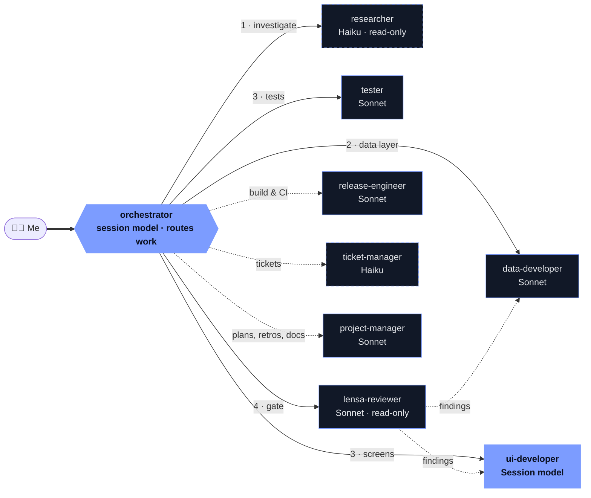

# Hi there , I'm Abdur Rohman

call me <b>Rohman</b> or <b>Maman</b>

  
  
  
  
  

---

## 💻 &nbsp;About Me

Senior Mobile Developer with **5+ years** building production Flutter apps and growing engineering talent. Hands-on with native Android (Kotlin, Java) and iOS (Swift, SwiftUI), plus backend in Spring Boot and Go, with a focus on pixel-perfect UI, app performance, and clean, testable code.

| 🎫 1,000+ | 📱 10+ | 🧑‍🏫 10+ | ⏳ 5+ |
| :---: | :---: | :---: | :---: |
| tickets shipped for Maukerja | client apps delivered | engineers mentored | years in mobile |

- 🏢 &nbsp;**Senior Flutter Developer** at [Maukerja Indonesia (AJobThing)](https://www.maukerja.my/) · May 2023 – present
- 🧑‍🏫 &nbsp;**Tech Fellow & Training Manager** at Refactory · 2021 – 2023
- 🎓 &nbsp;**Informatics**, [Universitas Muhammadiyah Surakarta](https://www.ums.ac.id/en/home/)
- 🏠 &nbsp;Based in **Yogyakarta, Indonesia**
- 🤖 &nbsp;Shipping with an AI-assisted workflow: **VS Code + Claude Code**, 9 orchestrated agents

## 🛠 &nbsp;Tech Stack

| | |
| :---: | :---: |
| **📱 Mobile** |  |
| **🌐 Backend** |  |
| **🛢 Data & Messaging** |  |
| **⚙️ Tools** |  |

Also: SwiftUI · Echo · Gin · REST · gRPC · Oracle · Hive · Xcode · Jira · Linear · Trello

## 🤖 &nbsp;AI Workflow

I write code in **VS Code** and pair with **Claude Code**. Multi-part work (a ticket, a review round, a cross-layer refactor) goes to an **orchestrator** agent that hands each piece to one specialist, one owner per file, and nothing is called done before the review gate.

🟦 <b>Session model</b> (inherits whatever the session runs: Fable, Opus or Sonnet) · filled &nbsp;|&nbsp; <b>Sonnet</b> · outlined &nbsp;|&nbsp; <b>Haiku</b> · dashed &nbsp;|&nbsp; numbers give the run order, dashed arrows run on demand

<b>Agent roster</b>

 

| Agent | Model | Owns |
| --- | --- | --- |
| `orchestrator` | Session model | Splits the task, dispatches specialists, reconciles results |
| `researcher` | Haiku | Where code lives, how a flow works, the ticket and API contract |
| `data-developer` | Sonnet | API clients, models, repositories, services, DI, native source |
| `ui-developer` | Session model | Pages, widgets, controllers, bindings, animations, routes |
| `tester` | Sonnet | Unit, widget and controller tests, mocks, coverage |
| `lensa-reviewer` | Sonnet | Self-review against the LenSa merge gate, verifies findings, writes the MR description, read-only |
| `release-engineer` | Sonnet | CI, fastlane, Gradle, Podfile, Xcode, signing, dependencies |
| `ticket-manager` | Haiku | Creating and splitting tickets in YouTrack |
| `project-manager` | Sonnet | Plans, reports, retros, README and `CLAUDE.md`, tuning the agents themselves |

Research first, then the data layer, then UI and tests against its interface (in parallel when the interface already exists), and the review gate before anything is called done.

## 📈 &nbsp;GitHub Stats

---

